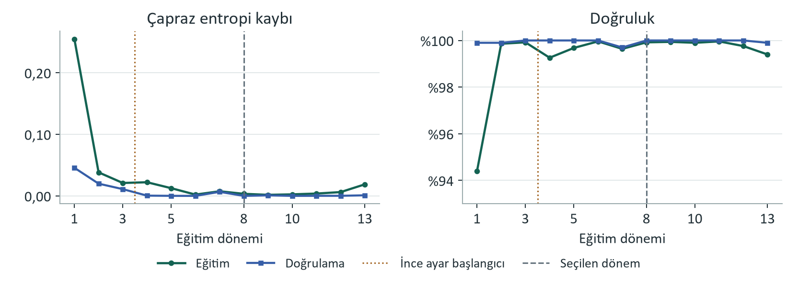
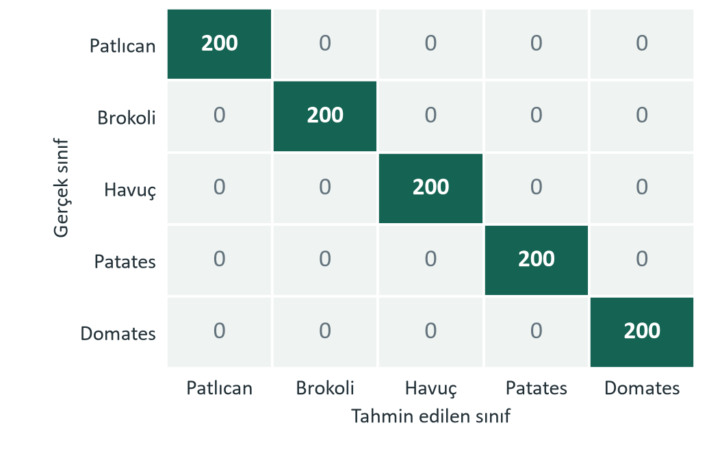
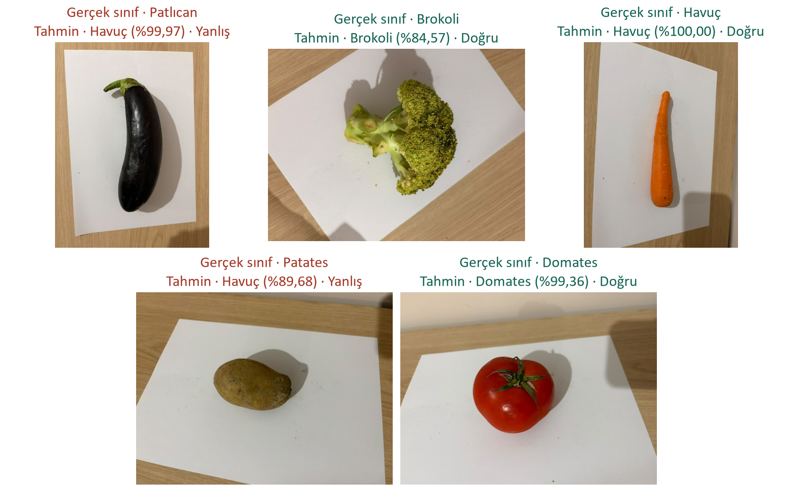
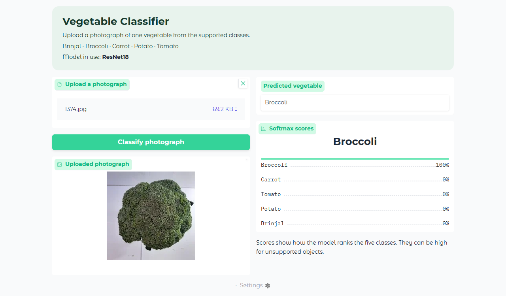

# Derin Öğrenme ile Beş Sebze Türünün Sınıflandırılması

**Kerem Yılmaz**

| Alan | Öğrenci yanıtı |
| --- | --- |
| Project Title | Derin Öğrenme ile Beş Sebze Türünün Sınıflandırılması |
| Problem / Task | Bir fotoğrafı beş sebze sınıfından birine atayan çok sınıflı görüntü sınıflandırma. |
| Dataset | Vegetable Image Dataset. 5.000 eğitim, 1.000 doğrulama ve 1.000 test görüntüsü. |
| Dataset URL | [https://www.kaggle.com/datasets/misrakahmed/vegetable-image-dataset](https://www.kaggle.com/datasets/misrakahmed/vegetable-image-dataset) |
| Model Architecture | Genel görsel özellikleri yeniden kullanmak için ImageNet-1K ağırlıklarıyla başlatılan ResNet18 ve beş çıkışlı doğrusal başlık. Karşılaştırma modeli sıfırdan eğitilen küçük bir CNN’dir. |
| Input Size | 224 × 224 piksel, RGB. En-boy oranı korunarak kenarlara dolgu eklenir. ImageNet kanal ortalamaları ve standart sapmaları kullanılır. |
| Hyperparameters | 32 görüntülük yığın, tohum 42. İlk 3 dönemde gövde ve BatchNorm istatistikleri sabit, başlık öğrenme hızı 0,001. İnce ayarda gövde 0,0001, başlık 0,0003. İnce ayar üst sınırı 20 dönem, erken durdurma sabrı 5 dönem. Toplam 13 dönem. |
| Optimizer | AdamW, ağırlık çürümesi 0,0001. AdamW uyarlanabilir adım büyüklüğü sağlar ve ağırlık çürümesini gradyan güncellemesinden ayrı uygular. |
| Activation / Output Function | Ara katmanlarda ReLU, çıkışta beş ham skor üreten doğrusal katman. Uygulama sınıf skorlarını göstermek için softmax kullanır. |
| Loss Function | CrossEntropyLoss. Birbirini dışlayan sınıflar için kayıp, doğrusal başlığın ham skorları üzerinden hesaplandı. |
| Evaluation Metrics | Doğruluk, makro kesinlik, makro duyarlılık ve makro F1. Eğitim ile çıkarım süreleri de ölçüldü. |
| Training Environment | Windows 11 Pro, Python 3.14.0, PyTorch 2.14.1+cu130, torchvision 0.29.1+cu130, CUDA 13.0 ve NVIDIA GeForce RTX 5070 Ti Laptop GPU. Eğitimde bfloat16 otomatik karma hassasiyet kullanıldı. |
| Best Performance | En düşük doğrulama kaybıyla 8. dönem seçildi (kayıp 0,000005711, doğruluk %100,00). Test doğruluğu %100,00 (1.000/1.000). Makro kesinlik, duyarlılık ve F1 değerleri sırasıyla 1,0000, 1,0000 ve 1,0000. Kişisel fotoğraflarda ilk beş görüntü 3/5, genişletilmiş koleksiyon 11/14. |
| Inference Time | Tek görüntü için CUDA ortalaması. İleri geçiş 4,264 ms, JPEG dosyasından sınıf skorlarına 6,349 ms. |
| Deployment Technology | Gradio 6.32.0 ile çalışan yerel web arayüzü. |
| Repository | [https://github.com/keremy321/VegetableClassifier](https://github.com/keremy321/VegetableClassifier) |

<!-- pagebreak -->

## Veri ve model karşılaştırması

Patlıcan, Brokoli, Havuç, Patates ve Domates için özgün eğitim, doğrulama ve test ayrımı korundu. Küçük CNN sıfırdan eğitildi. ImageNet-1K ön eğitimli ResNet18’de önce sınıflandırma başlığı eğitildi, ardından tüm ağa ince ayar yapıldı. Kişisel fotoğraflar eğitimde veya model seçiminde kullanılmadı.

EXIF yönü düzeltilen görüntüler bilineer yeniden boyutlandırma ve dolguyla 224 × 224 piksele getirildi. RGB kanal ortalamaları 0,485 / 0,456 / 0,406, standart sapmaları 0,229 / 0,224 / 0,225 idi. Eğitimde yatay çevirme (0,5 olasılıkla), ±10° dönme, eksen başına ±%5 öteleme, 0,94 ile 1,06 arasında ölçekleme ve sınırlı parlaklık, kontrast ve doygunluk değişimleri uygulandı.

| Ölçüt | Küçük CNN | ResNet18 |
| --- | --- | --- |
| Veri seti test doğruluğu | %97,70 | %100,00 |
| Test makro F1 | 0,9770 | 1,0000 |
| Eğitim süresi (s) | 115,56 | 326,44 |
| Ortalama ileri geçiş (ms) | 0,547 | 4,264 |
| Ortalama JPEG’den skorlara (ms) | 2,507 | 6,349 |

İki model, aynı JPEG ve GPU ile 1 görüntülük yığında, 20 ısınma ve 100 zamanlı tekrarla ölçüldü. İleri geçiş, GPU’daki hazır tensörden başlar. JPEG ölçümü görüntünün açılması, ön işleme, veri aktarımı ve softmax skorlarını içerir. Model yükleme ve arayüz süreleri ölçüm dışındadır.

<!-- pagebreak -->

## Kişisel fotoğraflarla değerlendirme

Şekil 3 ilk beş fotoğrafın tamamını gösterir. Genişletilmiş koleksiyonda 5 tam piksel eşleşmesi ve 9 ek benzersiz görüntü bulundu. Her görüntü bir kez sayıldı.

| Sınıf | İlk beş fotoğraf | Ek benzersiz | Toplam |
| --- | --- | --- | --- |
| Patlıcan | 0/1 | 0/1 | 0/2 |
| Brokoli | 1/1 | 2/2 | 3/3 |
| Havuç | 1/1 | 0 örnek | 1/1 |
| Patates | 0/1 | 4/4 | 4/5 |
| Domates | 1/1 | 2/2 | 3/3 |
| **Toplam** | **3/5** | **8/9** | **11/14** |

Koyu renkli ve uzun iki patlıcan fotoğrafı da Havuç olarak sınıflandırıldı. İlk patates fotoğrafı Havuç tahmini alırken iki patatesin yer aldığı dört ek fotoğraf doğru sınıflandırıldı. Sebze çeşidi, kadraj, arka plan ve aydınlatma sonuçları etkilemiş olabilir. Benzer sebzeler ve çekim ortamları içeren bu koleksiyon için sonuç **11/14** olarak ölçüldü.

<!-- pagebreak -->

## Uygulama

Kullanıcı yerel Gradio arayüzüne bir sebze fotoğrafı yükleyip sınıflandırmayı başlatır. ResNet18 en yüksek skoru alan sınıfı ve beş sınıfın softmax skorlarını görüntüler. Şekil 4, doğrulama kümesinden bir brokoli görüntüsüyle yapılan uygulama denemesini gösterir.

## Sınırlılıklar ve sonuç

Veri seti bölümleri arasında bazı neredeyse aynı görüntüler görsel incelemeyle doğrulandı. Bu benzerlik, %100,00 test doğruluğunun genelleme göstergesi olarak yorumlanmasını sınırlar. Algısal karma taramasındaki sayılar yalnızca inceleme adaylarını gösterir. ResNet18 ilk beş kişisel fotoğrafta 3/5, genişletilmiş koleksiyonda 11/14 doğru tahmin yaptı. Yüksek softmax skoru doğru tahmini garanti etmez. Genellemenin güvenilir biçimde ölçülmesi ve iyileştirilmesi için daha çeşitli, bağımsız olarak toplanmış görüntüler gerekir.

## Kaynaklar ve GitHub Deposu

Vegetable Image Dataset. [Kaggle veri seti](https://www.kaggle.com/datasets/misrakahmed/vegetable-image-dataset)

Uygulama belgeleri. [Torchvision ResNet18 ve ön eğitimli ağırlıklar](https://docs.pytorch.org/vision/stable/models/generated/torchvision.models.resnet18.html) · [Gradio](https://github.com/gradio-app/gradio#readme)

GitHub deposu. [https://github.com/keremy321/VegetableClassifier](https://github.com/keremy321/VegetableClassifier)
